# Azure Secure Landing Zone

[](https://github.com/jairos07/azure-secure-landing-zone/actions/workflows/checkov.yml)


Landing zone segura en Azure definida como código. Una red segmentada sin IPs públicas, una política que **impone** esa norma desde la propia Azure, un rol de mínimo privilegio y un pipeline que revisa el Terraform en cada cambio. Todo dentro del free tier de una suscripción *Azure for Students*.

> Proyecto de portfolio orientado a Cloud Security y Network Security. Toda la documentación está en español.

## En cifras

| Dato | Valor |
|---|---|
| Recursos definidos en Terraform | 12 (8 de red, 1 política y 3 de RBAC) |
| Controles de seguridad | 9 |
| Escaneo de Checkov sobre el código de red | 12 comprobaciones pasadas, 0 fallos |
| Problemas reales documentados | 6 |
| Regiones que permite la suscripción | 5 (se usa `germanywestcentral`) |
| Coste del entorno desplegado | **Pendiente de verificar** en Cost Management |

## Qué es

Un entorno pequeño en Azure construido con Terraform en el que la seguridad no se añade después, sino que forma parte del código:

1. El código se **revisa automáticamente** antes de desplegar (Checkov en GitHub Actions).
2. La red nace **segmentada** y con todo lo entrante denegado por defecto.
3. Una **política de Azure** impide crear IPs públicas, aunque alguien lo intente a mano.
4. Los permisos siguen el **mínimo privilegio**: un rol personalizado de solo lectura.
5. El repositorio está protegido para que **nunca se suban estados ni secretos**.

## Arquitectura

```
 GitHub (jairos07/azure-secure-landing-zone)
   |  push --> GitHub Actions --> Checkov (escaneo del Terraform)
   |
 Equipo local: Terraform + Azure CLI
   |  az login
   v
 AZURE  (suscripcion Azure for Students, region germanywestcentral)
 +------------------------------------------------------------------+
 |  Azure Policy (ambito: grupo de recursos rg-lz-lab)              |
 |    - Prohibir IPs publicas ............................ [Deny]   |
 |                                                                  |
 |  rg-lz-lab                                                       |
 |  +------------------------------------------------------------+  |
 |  |  vnet-lz-lab  10.10.0.0/16        (sin ninguna IP publica) |  |
 |  |                                                            |  |
 |  |   snet-mgmt      10.10.1.0/24                              |  |
 |  |     +-- nsg-mgmt-lz-lab: denegar todo lo entrante          |  |
 |  |                                                            |  |
 |  |   snet-workload  10.10.2.0/24                              |  |
 |  |     +-- nsg-workload-lz-lab:                               |  |
 |  |           SSH (22) solo desde 10.10.1.0/24                 |  |
 |  |           todo lo demas entrante: denegado                 |  |
 |  +------------------------------------------------------------+  |
 |                                                                  |
 |  id-auditor-lz-lab (identidad administrada)                      |
 |    +-- rol lz-auditor-red (solo lectura) en rg-lz-lab            |
 +------------------------------------------------------------------+
```

## Controles de seguridad

| Control | Riesgo que reduce | Cómo se implementa | Fichero | Evidencia |
|---|---|---|---|---|
| Sin IPs públicas | Superficie de ataque expuesta a Internet | Ningún recurso de tipo IP pública en el diseño | `network.tf` | `cap21.png` |
| Política `Deny` de IPs públicas | Que alguien cree una a mano o por error | Política integrada *Not allowed resource types* asignada al grupo de recursos | `policy.tf` | Salida del error (evidencia 8) |
| NSG de denegar-todo | Entrada de tráfico no previsto | Regla explícita de prioridad 4096 en ambas subredes | `network.tf` | `cap22.png` |
| SSH solo desde gestión | Fuerza bruta y movimiento lateral | Regla 100: puerto 22 únicamente desde `10.10.1.0/24` | `network.tf` | `cap22.png` |
| Segmentación | Que una zona comprometida llegue a la otra | Dos subredes con su propio NSG asociado | `network.tf` | `cap20.png` |
| Mínimo privilegio | Permisos excesivos | Rol con cinco acciones, todas `read`, limitado al grupo de recursos | `rbac.tf` | `cap27.png` |
| Escaneo del IaC | Malas configuraciones antes de desplegar | Checkov en cada `push` y `pull request`, con permisos de solo lectura | `.github/workflows/checkov.yml` | `cap6.png` y `cap8.png` |
| Protección del repo | Filtrar estado, variables o claves | `.gitignore` con `*.tfstate`, `*.tfvars` y `.terraform/` | `.gitignore` | [Hallazgo 1](docs/hallazgos.md) |
| Etiquetado | Trazabilidad y control de costes | `proyecto`, `entorno` y `gestionado_por` en todos los recursos | `network.tf` | `cap21.png` |

## Evidencias

Las capturas están en [`img/`](img/) y los identificadores de la suscripción y del directorio están tapados.

### 1. Escaneo local con Checkov

Sobre el código de red: 12 comprobaciones pasadas y 0 fallos. Este escaneo se hizo antes de añadir la política y el RBAC.

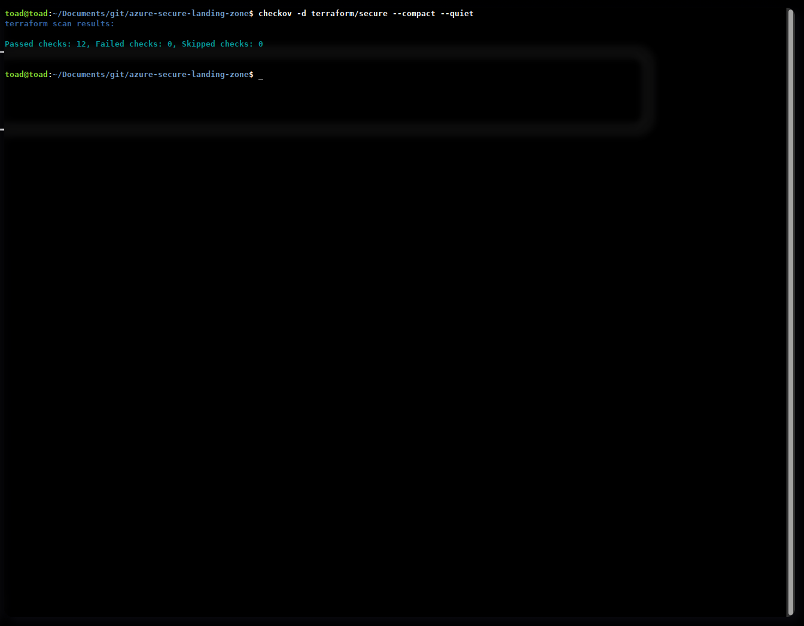

### 2. Pipeline de GitHub Actions

El mismo escaneo, ejecutado automáticamente en cada cambio.

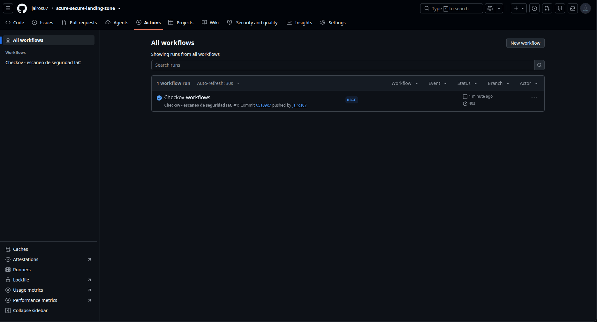

### 3. Validación de Terraform

`terraform init` y `terraform validate` correctos.

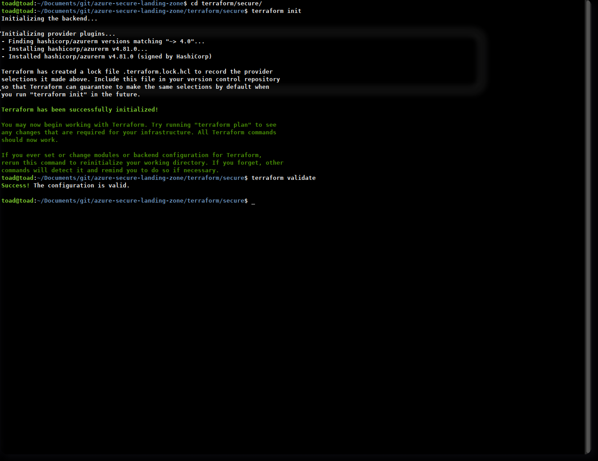

### 4. Despliegue final

Hecho en una región permitida por la suscripción: 8 recursos creados y 1 reemplazado.

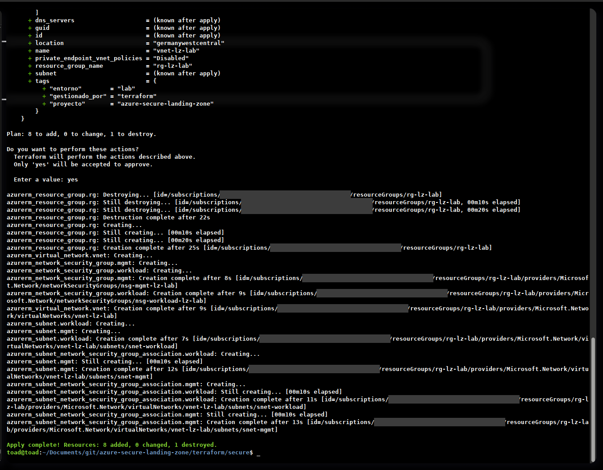

### 5. Grupo de recursos desplegado

La red y los dos NSG, todo etiquetado.

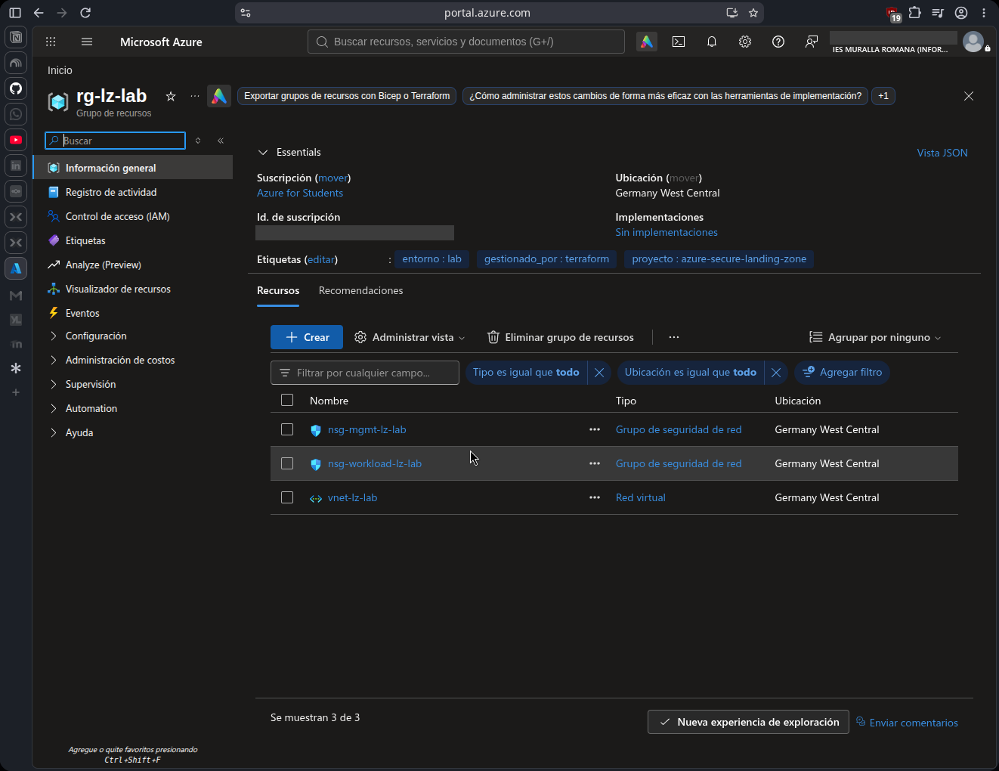

### 6. Red virtual

Espacio `10.10.0.0/16`, dos subredes y región Germany West Central.

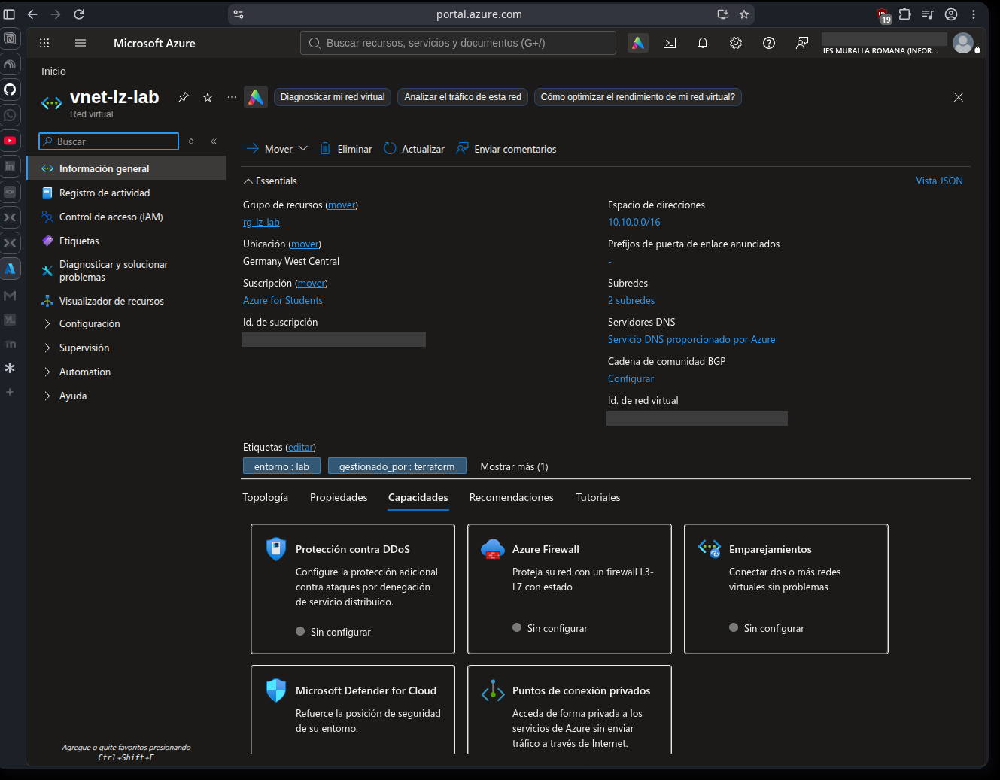

### 7. Reglas del NSG de cargas de trabajo

SSH solo desde la subred de gestión y el resto denegado.

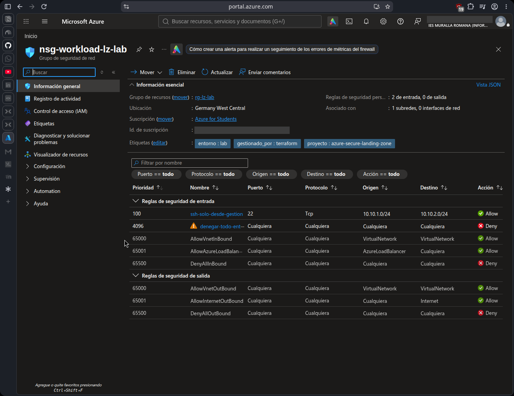

### 8. La política bloquea la creación de una IP pública

Salida real del intento, con el identificador de suscripción sustituido:

```text
(RequestDisallowedByPolicy) Resource 'pip-prueba-bloqueo' was disallowed by policy.
Policy identifiers: '[{"policyAssignment":{"name":"Prohibir IPs públicas en el lab",
"id":"/subscriptions/<ID-DE-SUSCRIPCION>/resourceGroups/rg-lz-lab/providers/
Microsoft.Authorization/policyAssignments/no-ip-publica"},
"policyDefinition":{"name":"Not allowed resource types", ...
Code: RequestDisallowedByPolicy
```

El intento se repitió dos veces con el mismo resultado y no se creó ninguna IP.

### 9. Rol personalizado y su asignación

Cinco acciones de lectura y una asignación a una identidad administrada.

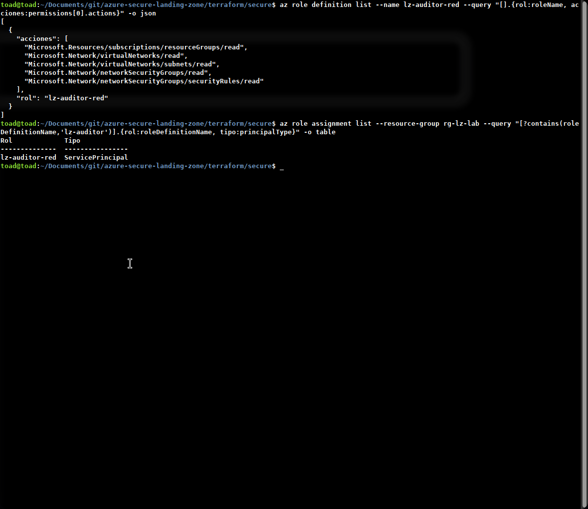

<details>
<summary>Más capturas del proceso</summary>

#### Primer plan, con la región que luego hubo que cambiar

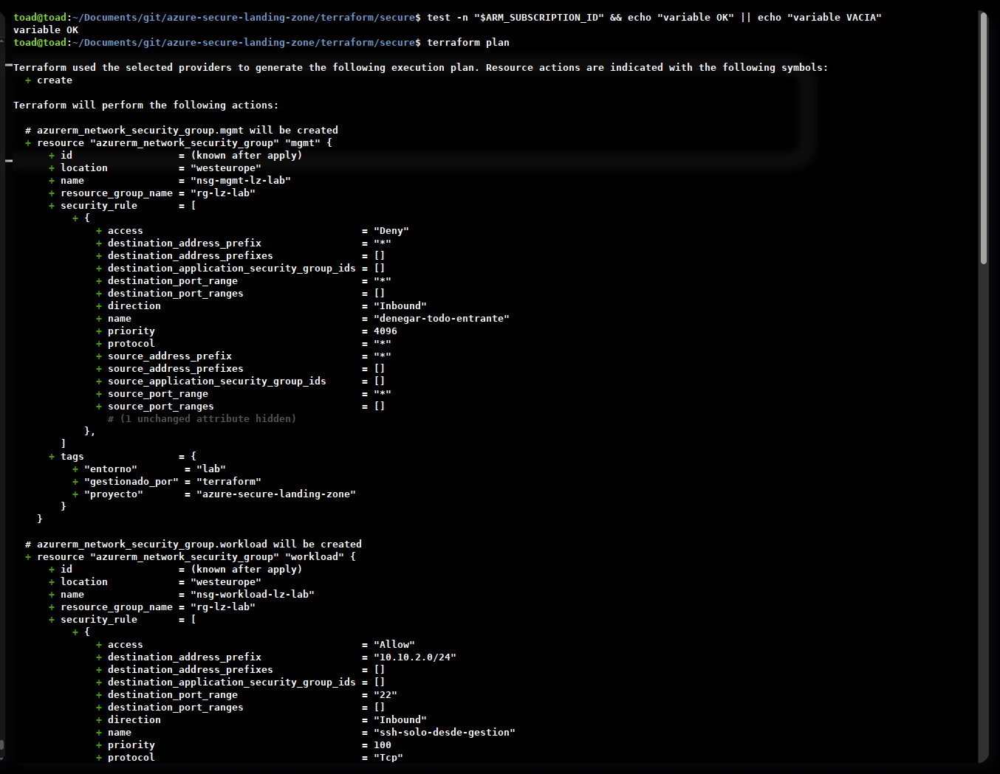

#### Plan del rol personalizado y acciones de lectura disponibles

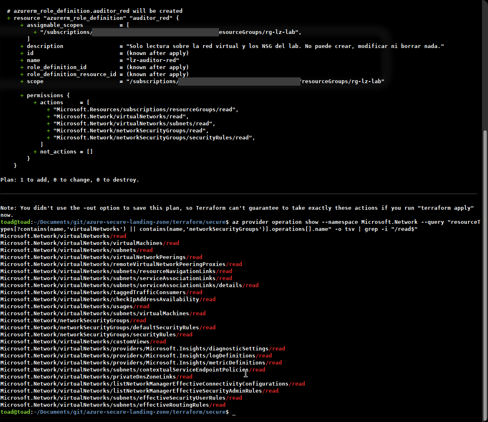

#### Inicio de sesión en Azure

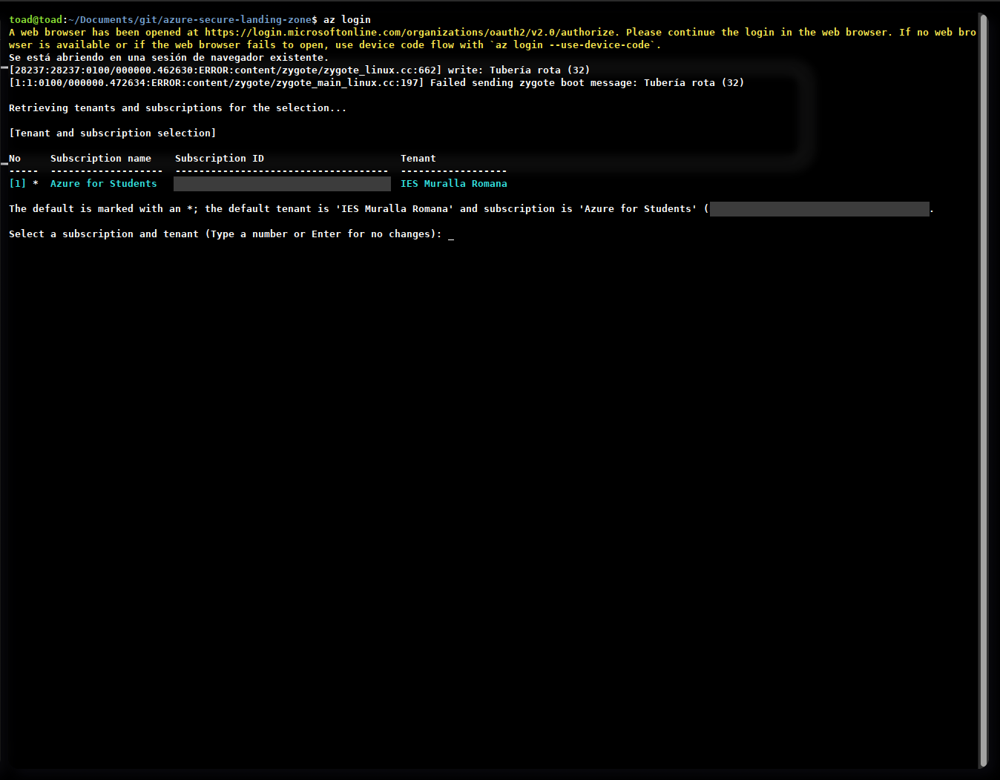

#### Versión de Terraform

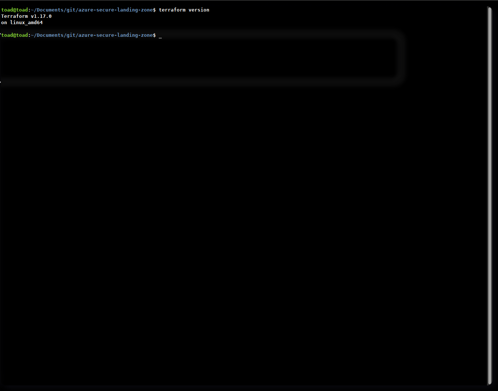

</details>


## Requisitos

| Herramienta | Versión usada |
|---|---|
| Terraform | 1.17.0 (mínimo exigido en el código: 1.5.0) |
| Proveedor `azurerm` | 4.81.0 |
| Azure CLI | 2.91.0 |
| Checkov | 3.3.30 |
| Sistema | Ubuntu 24.04 |

## Cómo reproducirlo

```bash
git clone https://github.com/jairos07/azure-secure-landing-zone.git
cd azure-secure-landing-zone/terraform/secure

az login
# El ID de suscripción NO se guarda en ningún fichero: solo en esta terminal
export ARM_SUBSCRIPTION_ID=$(az account show --query id -o tsv)

terraform init
terraform plan
terraform apply
```

Notas:

- La región por defecto es `germanywestcentral`. Si tu suscripción restringe regiones, cámbiala con `-var location=<región>`. Las regiones permitidas se consultan con `az policy assignment list`.
- La política se despliega en modo `Deny`. Para probar solo avisando: `-var efecto_politica=Audit`.
- Las políticas pueden tardar entre 15 y 30 minutos en aplicarse tras asignarlas.
- Para borrar todo: `terraform destroy`. Elimina también la política, el rol y la identidad.
- Se necesitan permisos de **Propietario** sobre la suscripción para asignar la política y crear el rol.

## Coste y free tier

El diseño evita lo que tiene coste: no hay máquinas virtuales, ni IPs públicas, ni espacios de trabajo de Log Analytics, ni cuentas de almacenamiento.

| Pieza | Coste esperado | Estado |
|---|---|---|
| Grupo de recursos, red virtual, subredes y NSG | 0, según mi conocimiento de los precios de Azure | **Pendiente de comprobar en Cost Management** |
| Azure Policy y RBAC | 0 | **Pendiente de comprobar** |
| Identidad administrada | 0 | **Pendiente de comprobar** |
| Terraform, Checkov y GitHub Actions | 0 (repositorio público) | Verificado |

Los datos de Cost Management tardan hasta 24 horas en aparecer, por eso esta comprobación está pendiente y no se da por hecha.

## Estado del proyecto

| Bloque | Estado |
|---|---|
| Red segmentada con NSG | Hecho y desplegado |
| Escaneo con Checkov en local y en CI | Hecho (ver nota en limitaciones) |
| Azure Policy en modo `Deny` con prueba de bloqueo | Hecho |
| RBAC de mínimo privilegio | Hecho |
| Comprobación de coste | Pendiente |
| Secure score de Defender for Cloud | Pendiente |
| Endurecer la salida a Internet de las subredes | Pendiente |

El detalle de lo que falta está en [`docs/limitaciones.md`](docs/limitaciones.md).
|

## Índice de capturas

Todas están en `img/`.

| Fichero | Qué muestra |
|---|---|
| `cap6.png` | Escaneo local de Checkov, 12 pasadas y 0 fallos |
| `cap8.png` | Pipeline de Checkov en verde |
| `cap17.png` | `init` y `validate` correctos |
| `cap18.png` | Primer plan, con la región que luego se cambió |
| `cap19.png` | Despliegue completo en `germanywestcentral` |
| `cap21.png` | Grupo de recursos en el portal |
| `cap20.png` | Red virtual en el portal |
| `cap22.png` | Reglas del NSG de cargas |
| `cap27.png` | Rol y asignación de RBAC |
| `cap12.png` | Versión de Terraform |
| `cap16.png` | Inicio de sesión en Azure |
| `cap26.png` | Plan del rol y acciones de lectura |

## Autor

Proyecto de portfolio de [jairos07](https://github.com/jairos07).
